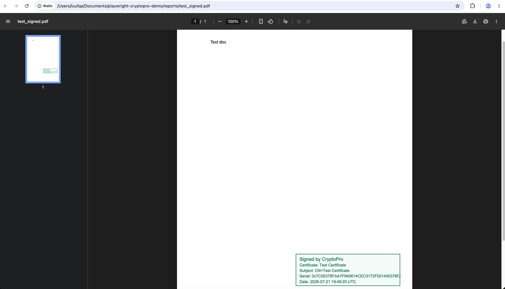
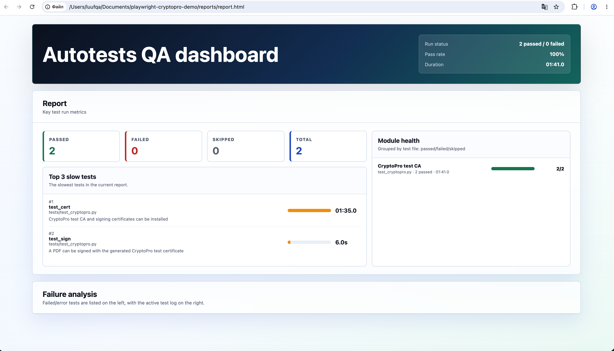

# playwright-cryptopro-demo

Demo project for running Playwright tests with Chromium-Gost and CryptoPro CSP in Docker.

## Project goal

This repository demonstrates an end-to-end document signing flow in a clean Docker environment.

The demo uses the public base image:

```dockerfile
FROM docker.io/luufqa/debian-cryptopro:latest
```

The base image is part of the demo setup and provides Debian, CryptoPro CSP, Chromium-Gost, the CryptoPro browser signing stack, Xvfb, x11vnc, noVNC, and websockify. This project adds Playwright tests, PDF signing logic, visible PDF stamp generation, and an HTML QA report on top of that base image.

The goal is to show that a fresh CryptoPro test CA certificate can be installed, a test document-signing certificate can be generated through the CryptoPro browser flow using entropy, and a PDF document can then be signed with that generated test certificate.

## Demo video

<video src="./docs/images/cryptopro-signing-demo.mov" controls width="100%"></video>

[Open the demo video](./docs/images/cryptopro-signing-demo.mov)

## Screenshots

Signed PDF opened in Chromium-Gost with the visible CryptoPro stamp:



Custom test report:



## What the tests do

- `test_cert` opens the CryptoPro test CA in Chromium-Gost, installs the current CryptoPro test CA certificate, and generates a signing certificate named `Test Certificate`.
- `test_sign` signs `files/test.pdf` with that generated certificate, verifies the detached CryptoPro CMS signature and certificate chain, embeds a visible PDF signature stamp, opens the signed PDF in Chromium-Gost, and saves a screenshot.

Generated artifacts are written to `reports/`:

- `report.html` - custom pytest HTML report
- `test_signed.pdf` - PDF with an embedded signature field and visible stamp
- `test_signed.p7s` - CMS/CAdES signature generated by CryptoPro
- `test_signed.png` - Chromium-Gost screenshot of the signed PDF

## Build

The base image is currently published for `linux/amd64`, so specify the platform explicitly on Apple Silicon.

```bash
docker build --platform linux/amd64 -t playwright-cryptopro-demo:local .
```

## Run

By default, the container stays alive after successful tests. This keeps noVNC open with the signed PDF loaded in Chromium-Gost so you can inspect the result manually.

```bash
mkdir -p reports
docker run --rm --platform linux/amd64 \
  -p 8081:8081 \
  -v "$PWD/reports:/app/reports" \
  playwright-cryptopro-demo:local
```

The container runs:

```bash
pytest -m sign
```

After `test_sign` passes, it opens `reports/test_signed.pdf` in Chromium-Gost and waits until you stop the container.

For CI or one-shot runs, disable the post-test noVNC hold:

```bash
docker run --rm --platform linux/amd64 \
  -e KEEP_NOVNC_OPEN=false \
  -v "$PWD/reports:/app/reports" \
  playwright-cryptopro-demo:local
```

## Watch the browser with noVNC

The base image starts Xvfb, x11vnc, noVNC, and websockify automatically.

Expose port `8081` when you run the container:

```bash
docker run --rm --platform linux/amd64 \
  -p 8081:8081 \
  -v "$PWD/reports:/app/reports" \
  playwright-cryptopro-demo:local
```

Then open:

```text
http://localhost:8081/vnc.html
```

If host port `8081` is already in use, map another host port to container port `8081`, for example `-p 8082:8081`, and open `http://localhost:8082/vnc.html`.

Use noVNC while the tests are running to watch Chromium-Gost, CryptoPro dialogs, certificate generation, and PDF rendering. After successful tests, Chromium-Gost remains open with `reports/test_signed.pdf` loaded. Stop the container manually when you are done reviewing it.

## Certificate chain validation

`test_cert` installs the CryptoPro test CA root certificate before issuing the signing certificate.

`test_sign` uses CryptoPro `cryptcp` with `-errchain`, so signing and verification fail if CryptoPro cannot build a trusted certificate chain. Revocation network checks are disabled with `-norev -nonet` to keep the demo deterministic inside Docker, but the certificate still has to be present, usable, and chainable to the installed test CA.

If the CryptoPro test CA root is not installed, or the generated signing certificate is not usable for signing, the signing step fails before `reports/test_signed.pdf` is produced.

## Report artifacts and Git

`reports/` is generated output and is ignored by both `.gitignore` and `.dockerignore`.

If you initialize Git after running the tests, the report files will stay untracked. If `reports/` was already committed before adding `.gitignore`, remove it from the index once:

```bash
git rm --cached -r reports
```

## License

This repository's own source code, tests, Dockerfile, report generator, PDF helper, documentation, and demo assets are released under the [MIT License](./LICENSE).

CryptoPro CSP, Chromium-Gost, Debian packages, browser components, and other third-party software used by the base image keep their own licenses and terms. The public base image `docker.io/luufqa/debian-cryptopro:latest` is used here as a demo dependency and is not relicensed by this repository.

## Publish example

```bash
docker tag playwright-cryptopro-demo:local luufqa/playwright-cryptopro-demo:latest
docker push luufqa/playwright-cryptopro-demo:latest
```
